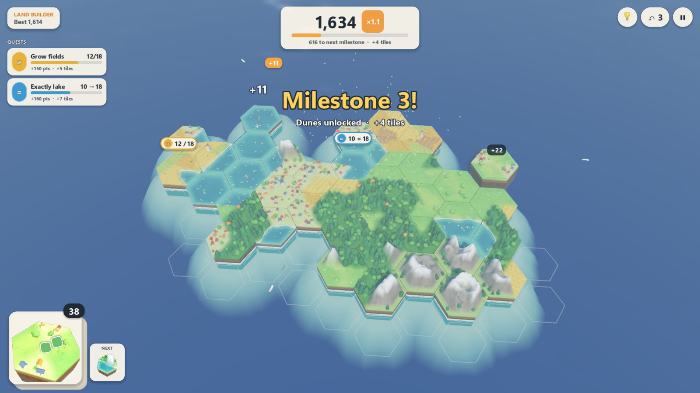
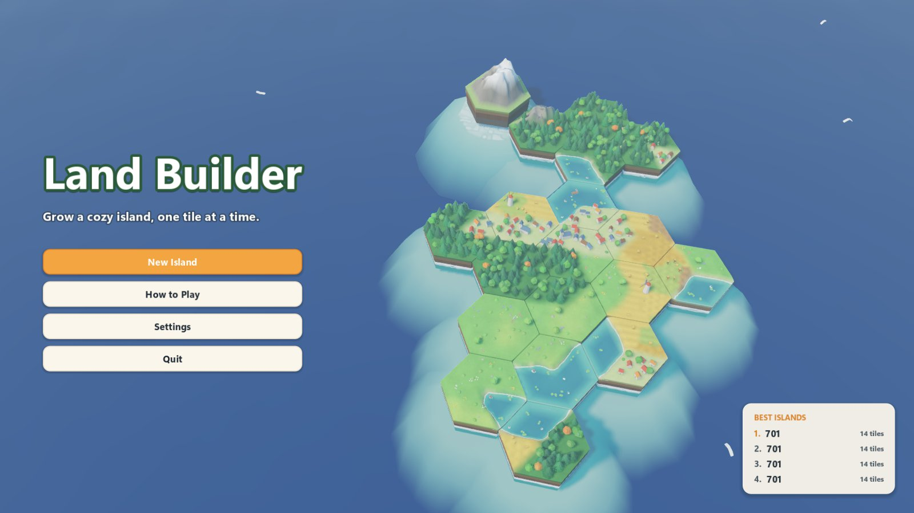
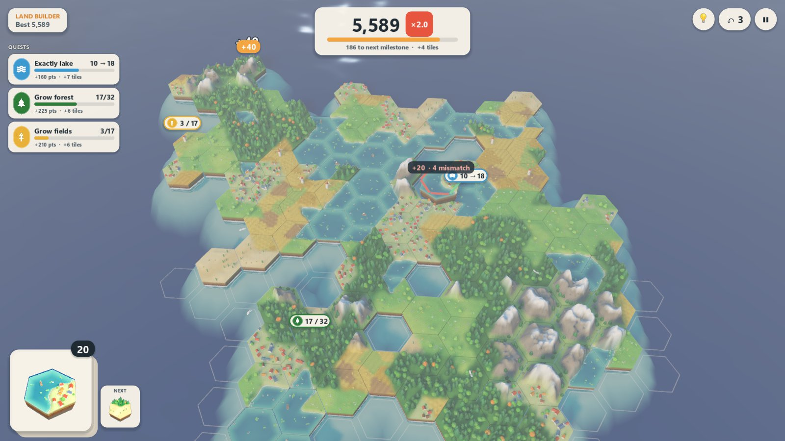

# Land Builder

A cozy hex tile-laying game in the spirit of *Dorfromantik*, *Islanders* and SayGames' *Land Builder*. Draw tiles from your stack, match their edges to grow an island, chase quests and keep the stack alive for as long as you can.

Built with **Godot 4.6 (.NET)** and C#. Every mesh, shader effect, icon and sound is generated in code, so there are no art or audio assets to manage.



| Title | Late in a run |
| --- | --- |
|  |  |

## Playing

| Action | Input |
| --- | --- |
| Place tile | Left click on a glowing outline |
| Rotate | `Q` / `E`, right-click, or `Shift` + mouse wheel |
| Pan | Left-drag, middle-drag or `WASD` / arrow keys |
| Orbit | Right-drag |
| Zoom | Mouse wheel |
| Re-centre | `F` |
| Hint | `H` or `Space` |
| Undo (3 per island) | `Ctrl+Z` or `Backspace` |
| Pause | `Esc` |
| Fullscreen | `F11` |

### Rules and scoring
- **Edges:** each tile has six wedges of terrain: meadow, forest, wheat field, village or lake, plus mountains and dunes once unlocked. Every edge that touches the same terrain scores **10 points**. Mismatches are allowed but score nothing.
- **Perfect / Flawless:** touch 3+ tiles with every edge matching for a *Perfect* (bonus points + 1 tile). Fill a hole with all six edges matching for a *Flawless* (+100, +2 tiles).
- **Streak:** clean fits against two or more tiles raise a multiplier (up to ×2.0). A mismatched edge resets it.
- **Quests:** pins appear over forests, fields, villages and lakes. Grow the area to the target (or *exactly* to it) for points and extra tiles. A quest fails if its area gets closed in or overshoots an exact target.
- **Milestones:** score thresholds award tiles and unlock Mountains (1st) and Dunes (3rd).
- **End of run:** the island is complete when the stack runs out. Runs autosave after every move, and **Continue** resumes them. Finished runs go on a local leaderboard.

All tuning numbers live in [`GameRules.cs`](src/LandBuilder.Core/Domain/GameRules.cs). A bot-driven balance test keeps the pacing in band.

## Running

```powershell
.\Start-LandBuilder.ps1            # build, run tests, launch the game
.\Start-LandBuilder.ps1 -SkipTests # just build and launch
.\Start-LandBuilder.ps1 -Editor    # open in the Godot editor
```

The script finds Godot through `GODOT_BIN`, `PATH`, or a Godot 4.6 .NET build in Downloads, Desktop or Program Files.

Alternatively, open the folder in Godot 4.6 .NET and press Play (`res://scenes/Main.tscn`).

## Testing

```powershell
dotnet test .\LandBuilder.sln
```

Rules, determinism, persistence and a balance simulation (a greedy bot plays full runs) are covered.

In-engine smoke test, which drives real mouse and keyboard events through the game and exits non-zero on failure:

```powershell
<godot-console-exe> --path . -- --selftest
```

Other debug flags (after `--`): `--autoplay` (a bot plays continuously), `--title` (attract-mode title screen), `--capture-dir=<dir> --capture-every=<frames>` (periodic screenshots plus FPS logging). Automated runs write to `user://automation/` and never touch your real save or leaderboard.

## Code layout

```
src/LandBuilder.Core/          Pure C# rules, no Godot dependency
  Domain/GameEngine.cs         Placement evaluation, scoring, quests, milestones, hint bot
  Domain/RegionMap.cs          Union-find over tile wedges for connected terrain areas
  Domain/TileGenerator.cs      Contiguous-segment tile generation with terrain affinities
  Application/GameSession.cs   Current run, undo history, event fan-out
  Infrastructure/              Save (schema 5) and leaderboard persistence
src/Presentation/              Godot layer
  Main.cs                      Flow, input, hand tile, event-to-feedback choreography
  BoardView.cs / TileVisual.cs Tile nodes, spring-driven drop/squash/ripple, affordances
  TerrainSampler.cs            Blended per-wedge height and colour (world-space noise)
  TileMeshBuilder.cs           Ground, skirt and lake meshes
  PropBuilder.cs               Trees, houses, windmills, boats... merged per tile
  WorldView.cs                 Sky, sun and day progression, ocean, seabed, clouds, birds
  CameraRig.cs                 Eased orbit camera, auto-framing, shake, tilt-shift DOF
  Hud.cs / Menus.cs / UiKit.cs In-game HUD, menus and the shared UI theme
  Audio.cs                     Synthesised SFX, ambience and generative music
shaders/                       terrain, props (pop-in + wind), water (depth foam)
tests/LandBuilder.Tests/       xUnit tests for the Core
```

Earlier milestone design notes are kept in [`docs/`](docs/) for history. The current rules are the ones described above.
